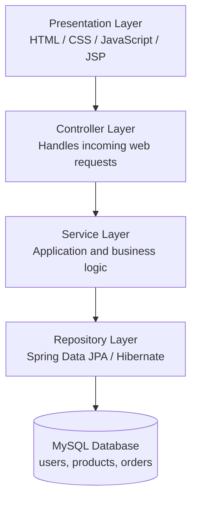
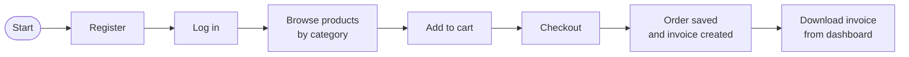
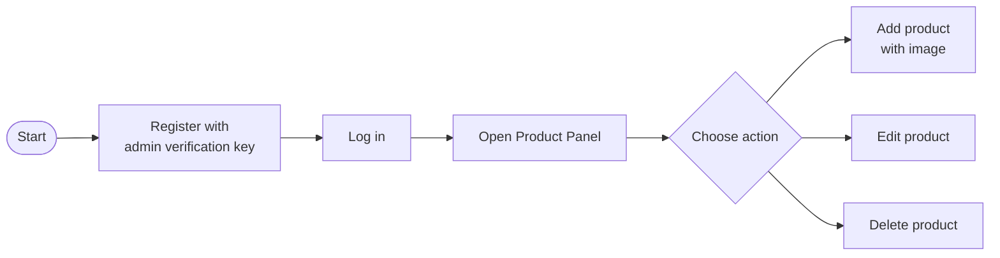
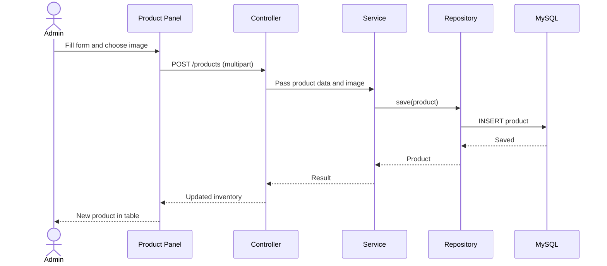
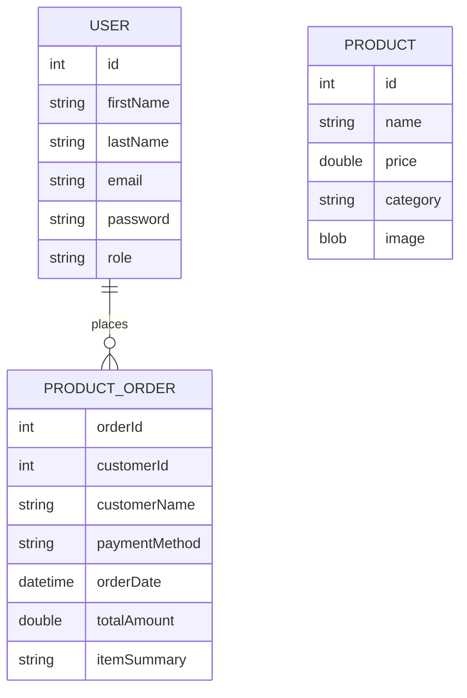
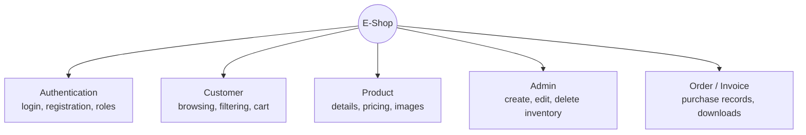

# 🛒 E-Shop — Role-Based E-Commerce Web Application

A role-based e-commerce web application built with **Java, JSP, Servlets and Spring Boot**, backed by **MySQL**. Customers can browse products by category, manage a cart and download past invoices, while admins manage the product catalogue through a dedicated panel.

Developed during a six-week Advanced Java industrial training at **Oops InfoSolutions Pvt. Ltd.** (10 June 2026 – 24 July 2026).

---

## ✨ Features

**Customer**
- Register and log in as a standard user
- Browse products grouped by category (e.g. Stationery, Electronics)
- Add items to a shopping cart and proceed to checkout
- View and download past invoices

**Admin**
- Separate admin registration protected by an administrator verification key
- Add products with name, price, category and image upload
- Edit and delete existing products from the inventory table

---

## 🧰 Tech Stack

| Layer | Technology |
|---|---|
| Language | Java |
| Web | JSP, Servlets |
| Framework | Spring Boot |
| Persistence | Spring Data JPA, Hibernate |
| Database | MySQL |
| Frontend | HTML, CSS, JavaScript |
| Build tool | Maven |

---

## 🏗️ Architecture

The app follows a layered architecture. Each layer only talks to the one directly below it.



Multipart upload handling in the controller and service layers supports product image storage.

---

## 🔄 Application Flow

### Customer journey



### Admin journey



### Adding a product (request flow)



---

## 🗃️ Data Model



| Entity | Purpose |
|---|---|
| `User` | Registered users and their role (user / admin) |
| `Product` | Inventory items, including category, price and image |
| `ProductOrder` | Completed orders used to generate invoices. Purchased items are stored in `itemSummary` |

---

## 🧩 Modules



---

## 🔌 Endpoints

| Method | Endpoint | Purpose |
|---|---|---|
| POST | `/user` | Register a new user |
| POST | `/login` | Authenticate a user or admin |
| GET | `/product` | Retrieve all products |
| POST | `/products` | Add a new product (with image upload) |
| POST | `/products/{id}` | Update an existing product |
| POST | `/products/delete/{id}` | Delete a product |
| POST | `/api/orders` | Create an order |
| GET | `/api/orders` | Retrieve orders and invoices |

## 🚀 Getting Started

### Prerequisites
- JDK (version used by the project)
- Maven
- MySQL Server

### Setup

1. **Clone the repository**
   ```bash
   git clone https://github.com/<your-username>/<your-repo-name>.git
   cd <your-repo-name>
   ```

2. **Create the database**
   ```sql
   CREATE DATABASE eshop;
   ```

3. **Configure the database connection** in `src/main/resources/application.properties`
   ```properties
   spring.datasource.url=jdbc:mysql://localhost:3306/eshop
   spring.datasource.username=<your-mysql-username>
   spring.datasource.password=<your-mysql-password>
   spring.jpa.hibernate.ddl-auto=update
   ```

4. **Run the application**
   ```bash
   mvn spring-boot:run
   ```

5. **Open in your browser**
   ```
   http://localhost:8080
   ```

---

## 🧪 Testing Performed

- User registration and login interfaces
- Separate standard-user and system-admin registration flows
- Product display by category
- Shopping-cart interface and checkout state
- Admin add, edit and delete operations
- Invoice history and download controls

---

## 🔮 Future Scope

- [ ] Online payment gateway integration
- [ ] Stronger password security (hashed passwords, Spring Security)
- [ ] Product search
- [ ] Order tracking
- [ ] Cloud deployment

---

## 📚 What I Learned

- Building Java web applications end to end with JSP, Servlets and Spring Boot
- Layered application architecture
- Integrating backend logic with a relational database using JPA and Hibernate
- Role-based application workflows
- Debugging and testing real integration issues

---

## 👩‍💻 Author

**Ayushika**
B.Tech (Computer Science and Engineering), 2024–2028
Ambala College of Engineering and Applied Research, Kurukshetra University
